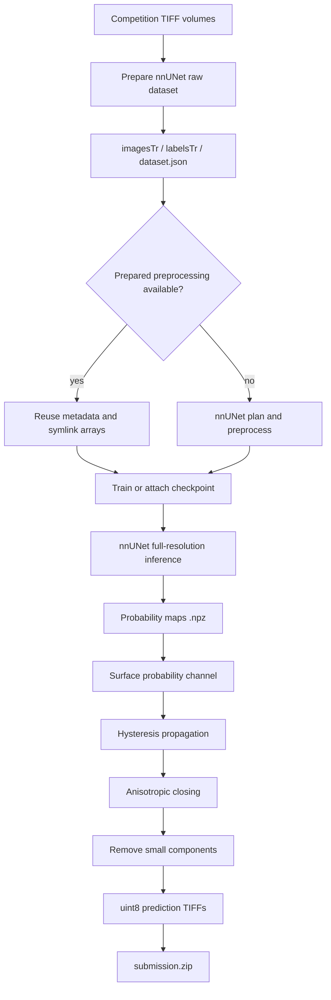

# Vesuvius Challenge – Surface Detection

<p align="center">
  <a href="https://www.kaggle.com/competitions/vesuvius-challenge-surface-detection"></a>
  <a href="https://storage.googleapis.com/kaggle-competition-certificates/31156518/532b9eb8ee7083b247b4da26621806d6.png"></a>
  
  
  
  
</p>

<p align="center"><b>English</b> | <a href="./README_zh.md">简体中文</a></p>

<div align="center">
  <a href="https://storage.googleapis.com/kaggle-competition-certificates/31156518/532b9eb8ee7083b247b4da26621806d6.png">
    
  </a>
  <p><em>Official Kaggle award certificate — Bronze Medal, rank 85 of 1,391 teams</em></p>
</div>

## Overview

This repository preserves the archived Kaggle notebook for **Vesuvius Challenge – Surface Detection**. The pipeline converts volumetric TIFF data into an nnUNet dataset, optionally reuses prepared preprocessing artifacts, runs full-resolution inference from a prepared checkpoint, refines the surface probability map, and packages the resulting masks into `submission.zip`.

### Highlights

- **3D segmentation:** `3d_fullres` nnUNet pipeline with `nnUNetPlannerResEncM` and `nnUNetResEncUNetMPlans`.
- **Memory-aware data handling:** symlinked raw volumes and optional reuse of prepared preprocessing artifacts.
- **Checkpoint-based inference:** archived final path uses `fold_all/checkpoint_best.pth` from the 2,000-epoch trainer tree.
- **Mask refinement:** class-1 probability extraction, hysteresis propagation, anisotropic closing, and connected-component filtering.
- **Award evidence:** Bronze Medal, rank 85 of 1,391 teams; archived certificate and official links are under `evidence/`.

The final archived notebook performs inference from a supplied checkpoint. It contains wrappers for dataset preparation and training, but the checked-in final path does not include a complete fold-wise CV ledger or a fresh training run.

## Architecture



## Technical Implementation

### Dataset preparation

The notebook expects `train_images/*.tif`, `train_labels/*.tif`, and `test_images/*.tif`. It creates `Dataset100_VesuviusSurface`, maps images to nnUNet's `_0000.tif` convention, writes JSON spacing sidecars, and declares `background=0`, `surface=1`, and `ignore=2` in `dataset.json`. Raw files are symlinked by default to avoid duplicating large volumes.

When `/kaggle/input/vesuvius-surface-nnunet-preprocessed` is available, metadata is copied while large `.npz`, `.npy`, and `.b2nd` artifacts are symlinked. Otherwise, the notebook runs the nnUNet planner and preprocessor.

### Model and inference configuration

| Component | Archived setting |
| --- | --- |
| Framework | `nnunetv2` with PyTorch |
| Dataset | `Dataset100_VesuviusSurface` |
| Configuration | `3d_fullres` |
| Planner | `nnUNetPlannerResEncM` |
| Plans | `nnUNetResEncUNetMPlans` |
| Final fold | `all` |
| Final checkpoint | `fold_all/checkpoint_best.pth` in the 2,000-epoch trainer tree |
| Final mode | `do_preprocess=False`, `do_train=False` |

The repository does not define a custom neural-network class, custom loss, optimizer, scheduler, EMA, AMP block, pseudo-labeling method, or custom head; those behaviors are provided by the nnUNet runtime.

### Post-processing

The final mask refinement is explicit:

1. Load `probabilities` from each nnUNet `.npz` file.
2. Use channel `1` as the surface probability map.
3. Create strong seeds with `probability >= 0.8`.
4. Propagate through `probability >= 0.25` or the non-background argmax anchor.
5. Use full 3D connectivity for propagation.
6. Apply anisotropic closing with `radius_z=3` and `radius_xy=2`.
7. Remove connected components smaller than `250` voxels.
8. Save the final mask as `uint8` TIFF and package it into `submission.zip`.

## Evaluation and Evidence

The archived portfolio evidence records a **private leaderboard score of 0.58952**, Bronze Medal, rank 85 of 1,391 teams. The repository does not include a complete fold-wise CV or ablation ledger, so those values are not presented as if they existed.

| Evidence | Record |
| --- | --- |
| Award | Bronze Medal |
| Rank | 85 / 1,391 teams |
| Private leaderboard | `0.58952` |
| Final inference | Single `fold_all` checkpoint path |
| Official certificate | `evidence/vesuvius-bronze-certificate.png` |

## Repository Structure

```text
.
├── assets/
│   └── certificate.png                         # README hero image
├── evidence/
│   ├── links.md                                # Official Kaggle links
│   └── vesuvius-bronze-certificate.png        # Archived certificate image
├── submission/
│   └── fork-of-surface-nnunet-training-inference-p.ipynb
│                                                  # Downloaded Kaggle notebook
├── README.md                                    # English documentation
└── README_zh.md                                 # Simplified Chinese documentation
```

## Reproducibility

### Kaggle inputs

Mount the competition data at:

```text
/kaggle/input/vesuvius-challenge-surface-detection/
├── train_images/*.tif
├── train_labels/*.tif
└── test_images/*.tif
```

Optional prepared preprocessing artifacts:

```text
/kaggle/input/vesuvius-surface-nnunet-preprocessed
```

### Training and inference wrappers

```python
setup_environment()
prepare_dataset(INPUT_DIR)
run_preprocessing(
    dataset_id=100,
    planner="nnUNetPlannerResEncM",
    configurations=["3d_fullres"],
)
run_training(
    dataset_id=100,
    config="3d_fullres",
    fold="all",
    plans="nnUNetResEncUNetMPlans",
    epochs=None,
)
```

For the archived final path, use the prepared checkpoint and skip preprocessing/training:

```python
full_pipeline(
    do_preprocess=False,
    do_train=False,
    model_path=(
        "/kaggle/working/nnUNet_results/"
        "Dataset100_VesuviusSurface/"
        "nnUNetTrainer_2000epochs__nnUNetResEncUNetMPlans__3d_fullres/"
        "fold_all/checkpoint_best.pth"
    ),
)
generate_submission()
```

The generated artifact is `/kaggle/working/submission.zip`. The archive excludes the original volumes, prepared arrays, checkpoints, and generated ZIP, so reproducing the full run requires the original Kaggle inputs and sufficient storage for 3D preprocessing.

## Official Links

- [Competition](https://www.kaggle.com/competitions/vesuvius-challenge-surface-detection)
- [Kaggle notebook, script version 300492446](https://www.kaggle.com/code/ydhdhej/fork-of-surface-nnunet-training-inference-p?scriptVersionId=300492446)
- [Official certificate image](https://storage.googleapis.com/kaggle-competition-certificates/31156518/532b9eb8ee7083b247b4da26621806d6.png)
