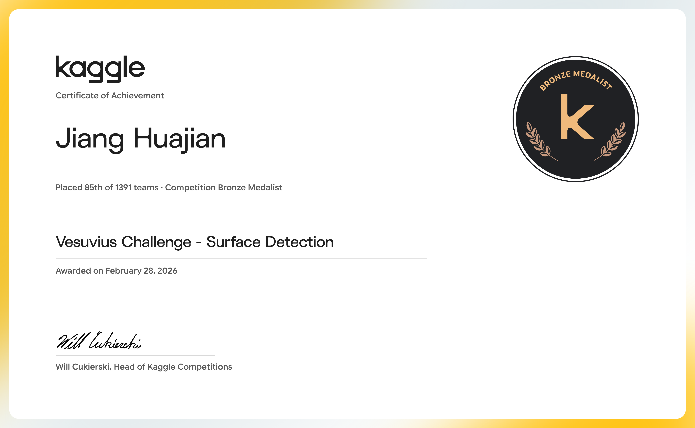
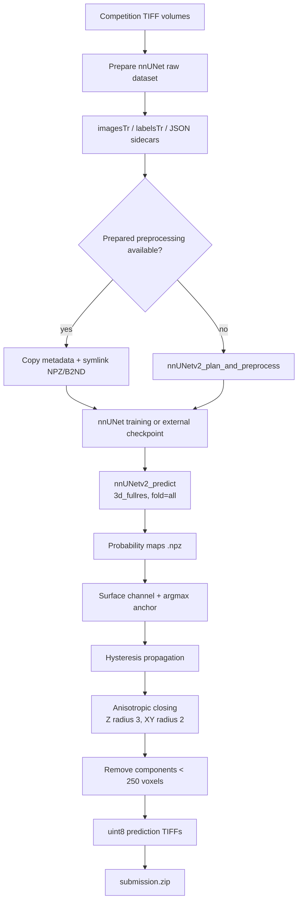

# 🏆 Vesuvius Challenge - Surface Detection — Bronze Medal, Rank 85/1,391

<p align="center">
  <a href="https://img.shields.io/badge/Kaggle-Competition-20BEFF?logo=kaggle&logoColor=white&style=flat-square"></a>
  <a href="https://img.shields.io/badge/Award-Bronze%20%7C%2085%2F1391-CD7F32?style=flat-square"></a>
  <a href="https://img.shields.io/badge/Metric-Official%20leaderboard%20score-555555?style=flat-square"></a>
  <a href="https://img.shields.io/badge/Python-3.11-3776AB?logo=python&logoColor=white&style=flat-square"></a>
  <a href="https://img.shields.io/badge/Stack-nnUNet%20%7C%20PyTorch-EE4C2C?logo=pytorch&logoColor=white&style=flat-square"></a>
  <a href="https://img.shields.io/badge/License-Not%20specified-lightgrey?style=flat-square"></a>
</p>

<p align="center"><b>English</b> | <a href="./README_zh.md">简体中文</a></p>

<div align="center">
  <a href="https://storage.googleapis.com/kaggle-competition-certificates/31156518/532b9eb8ee7083b247b4da26621806d6.png">
    
  </a>
  <p><em>🏅 Official Kaggle Competition Award Certificate — Bronze Medal, 85th of 1,391 teams</em></p>
</div>

## 1. Executive Summary

This repository preserves a Kaggle Notebook for **Vesuvius Challenge - Surface Detection**. The code builds a 3D nnUNet dataset from TIFF volumes, optionally reuses a prepared preprocessed dataset, trains or attaches an nnUNet checkpoint, runs full-resolution inference with saved probability maps, refines the surface mask, and packages the resulting TIFF files into `submission.zip`.

The tracked Notebook keeps its source cells and runtime metadata; generated cell outputs are intentionally stripped to keep the repository reviewable and avoid storing transient 3D visualizations or logs.

### Problem and Core Challenges

- **Task:** 3D voxel segmentation of a surface class from volumetric TIFF inputs.
- **Input format:** `train_images/*.tif`, `train_labels/*.tif`, and `test_images/*.tif` under the Kaggle competition directory.
- **Label contract:** background `0`, surface `1`, ignore `2`.
- **Systems constraints:** 3D volumes are large, so the pipeline uses symlinks, optional prepared preprocessing, configurable workers, and persisted nnUNet results.
- **Official metric:** the exact metric definition is not encoded in the archived Notebook; `[TODO: record the official Vesuvius metric definition]`.

### Winning Approach Overview

The pipeline uses `3d_fullres` with `nnUNetPlannerResEncM` and `nnUNetResEncUNetMPlans`. The final Notebook invocation skips preprocessing and training, attaches a `checkpoint_best.pth` from a prepared `nnUNetTrainer_2000epochs` result tree, and performs inference with probability saving enabled. A custom post-processing stage extracts the surface probability channel, uses hysteresis propagation from strong seeds through a weak region, applies anisotropic morphological closing, removes small components, and writes uint8 TIFF masks before zipping them.

## 2. Solution Architecture and Pipeline



### Pipeline Stages

1. **Environment:** set `nnUNet_raw`, `nnUNet_preprocessed`, `nnUNet_results`, `nnUNet_compile`, and `nnUNet_USE_BLOSC2=1`.
2. **Raw conversion:** create `Dataset100_VesuviusSurface`, use symlinks for input TIFFs, write JSON spacing sidecars, and generate a `dataset.json` with `SimpleTiffIO`.
3. **Preprocessing:** reuse `/kaggle/input/vesuvius-surface-nnunet-preprocessed` when available; otherwise run the nnUNet planner/preprocessor.
4. **Training or checkpoint mapping:** train a selected fold or map an external `.pth` file to `checkpoint_final.pth` so nnUNet can discover it.
5. **Inference:** prepare test TIFFs as `_0000.tif`, run `nnUNetv2_predict` with `--save_probabilities`, and retain `.npz` maps for post-processing.
6. **Mask refinement and packaging:** refine class-1 probabilities, write TIFF masks, and zip only the filenames at the archive root.

## 3. Key Technical Insights

### 3.1 Validation Strategy

The code supports two fold modes:

- `FOLD=0..4` for five-fold validation or fold-level ensembling;
- `FOLD="all"` for full-data training and final inference.

The archived final cell uses `fold="all"`, `do_preprocess=False`, and `do_train=False`, so the checked-in Notebook does **not** contain a complete five-fold CV result table. It performs single-model inference from the supplied external checkpoint. `[TODO: add fold-wise CV scores if those experiments are available]`.

### 3.2 Data Preparation and Representation

- The input contract is `train_images`, `train_labels`, and `test_images` directories of TIFF volumes.
- Training images are mapped to nnUNet's `imagesTr/{case}_0000.tif`; labels become `labelsTr/{case}.tif`.
- JSON sidecars store isotropic spacing `[1.0, 1.0, 1.0]`.
- `dataset.json` declares one channel named `CT`, labels `background=0`, `surface=1`, `ignore=2`, and `overwrite_image_reader_writer="SimpleTiffIO"`.
- Raw files are symlinked by default to avoid duplicating large volumes.
- Preprocessed metadata files are copied, while heavy `.npz`, `.npy`, and `.b2nd` files are symlinked when a prepared dataset is available.

### 3.3 Model Design and Training Configuration

The model is delegated to nnUNet rather than implemented as a custom PyTorch class:

| Component | Code-backed setting |
| --- | --- |
| Framework | `nnunetv2` with PyTorch underneath |
| Dataset ID | `100` (`Dataset100_VesuviusSurface`) |
| Configuration | `3d_fullres` |
| Planner | `nnUNetPlannerResEncM` |
| Plans | `nnUNetResEncUNetMPlans` |
| Default fold | `all` |
| Default epoch mapping | `EPOCHS=None` maps to `nnUNetTrainer` (the helper treats this as 1,000 epochs) |
| Final archived checkpoint | `nnUNetTrainer_2000epochs__nnUNetResEncUNetMPlans__3d_fullres/fold_all/checkpoint_best.pth` |
| GPU selection | `torch.cuda.device_count()` with automatic `-num_gpus` when greater than one |

There is no custom Loss, optimizer, scheduler, EMA, AMP block, pseudo-labeling, or neural-network head in the archived code; those behaviors are supplied by the nnUNet runtime.

### 3.4 Inference and Post-processing

The post-processing implementation is explicit and reproducible:

1. Load `probabilities` from each nnUNet `.npz` file.
2. Use class channel `1` as the surface probability map.
3. Build an anchor mask from `argmax(probabilities) != 0`.
4. Mark strong seeds with `probability >= 0.8`.
5. Allow propagation through `probability >= 0.25` or the anchor mask.
6. Propagate with a full 3D connectivity structure.
7. Apply a custom anisotropic kernel with `radius_z=3` and `radius_xy=2`.
8. Remove connected components smaller than `250` voxels.
9. Save the result as `uint8` TIFF.

The final call is not an ensemble: it uses `fold_all` from the supplied checkpoint. The helper functions can run other folds, but no fold blend is executed by the archived final cell.

### 3.5 What Did Not Work / Open Ablations

- `[TODO]` Compare `3d_fullres` with the code-documented `2d`, `3d_lowres`, and cascade configurations.
- `[TODO]` Compare standard nnUNet planner against `nnUNetPlannerResEncM`.
- `[TODO]` Quantify hysteresis thresholds, anisotropic closing, and component filtering separately.
- `[TODO]` Add fold-0..4 ensemble results if they were used in the competition process.

## 4. Validation and Ablation Results

The archived portfolio evidence records **Bronze Medal, rank 85/1,391, private leaderboard score 0.58952, awarded February 28, 2026**. The Notebook itself does not include a complete ablation ledger.

| Stage / Experiment | Key Changes | Local CV | Public LB | Private LB |
| :--- | :--- | :---: | :---: | :---: |
| Baseline | nnUNet dataset conversion and default inference | `[TODO]` | `[TODO]` | `[TODO]` |
| Full-resolution model | `3d_fullres` + `nnUNetPlannerResEncM` | `[TODO]` | `[TODO]` | `[TODO]` |
| External checkpoint path | `nnUNetTrainer_2000epochs`, `fold_all`, `checkpoint_best.pth` | N/A | `[TODO]` | `0.58952 (archived record)` |
| Final mask refinement | Hysteresis + closing + small-component removal | `[TODO]` | `[TODO]` | `[TODO]` |

## 5. Repository Structure

```text
.
├── assets/
│   └── certificate.png                         # README Hero certificate image
├── evidence/
│   ├── links.md                                # Official Kaggle links
│   └── vesuvius-bronze-certificate.png        # Archived certificate image
├── submission/
│   └── fork-of-surface-nnunet-training-inference-p.ipynb
│                                                  # Downloaded Kaggle Notebook
├── README.md                                    # English technical documentation
└── README_zh.md                                 # Simplified Chinese technical documentation
```

## 6. Environment and Reproducibility

### 6.1 Hardware and Runtime

- Notebook metadata declares an NVIDIA Tesla T4 runtime and Python 3.11.13.
- The code dynamically detects available CUDA GPUs and can add `-num_gpus N` when more than one GPU is visible.
- The final archived invocation uses an external 2,000-epoch checkpoint and skips training.
- `[TODO: record exact GPU count, VRAM, preprocessing duration, inference duration, and ZIP size]`.

### 6.2 Installation

The Notebook installs from Kaggle's offline package directory:

```bash
pip install nnunetv2 nibabel tifffile tqdm \
  --no-index -f /kaggle/input/surface-packages-offline
```

It also imports `numpy`, `pandas`, `matplotlib`, `scipy`, `scikit-image`, and `tifffile`.

### 6.3 Data Preparation

Mount the competition data at:

```text
/kaggle/input/vesuvius-challenge-surface-detection/
├── train_images/*.tif
├── train_labels/*.tif
└── test_images/*.tif
```

An optional prepared preprocessing dataset may be mounted at:

```text
/kaggle/input/vesuvius-surface-nnunet-preprocessed
```

### 6.4 Training, Inference, and Submission Commands

The Notebook exposes Python wrappers around the real nnUNet commands:

```python
setup_environment()
prepare_dataset(INPUT_DIR)
run_preprocessing(
    dataset_id=100,
    planner="nnUNetPlannerResEncM",
    configurations=["3d_fullres"],
)
run_training(
    dataset_id=100,
    config="3d_fullres",
    fold="all",
    plans="nnUNetResEncUNetMPlans",
    epochs=None,
)
```

For the archived final path, use the external checkpoint exactly as the final cell does:

```python
full_pipeline(
    do_preprocess=False,
    do_train=False,
    model_path=(
        "/kaggle/working/nnUNet_results/"
        "Dataset100_VesuviusSurface/"
        "nnUNetTrainer_2000epochs__nnUNetResEncUNetMPlans__3d_fullres/"
        "fold_all/checkpoint_best.pth"
    ),
)
generate_submission()
```

The generated artifact is `/kaggle/working/submission.zip`. By default, `generate_submission()` deletes the intermediate TIFF files after adding them to the ZIP.

### 6.5 Reproducibility Boundaries

The archive excludes the large competition volumes, preprocessed arrays, nnUNet checkpoints, and generated ZIP. Reproduction requires the original Kaggle datasets, the prepared checkpoint or a full training run, compatible nnUNet versions, and sufficient local storage for 3D preprocessing.

## Official Links

- [Competition](https://www.kaggle.com/competitions/vesuvius-challenge-surface-detection)
- [Kaggle Notebook, script version 300492446](https://www.kaggle.com/code/ydhdhej/fork-of-surface-nnunet-training-inference-p?scriptVersionId=300492446)
- [Official certificate image](https://storage.googleapis.com/kaggle-competition-certificates/31156518/532b9eb8ee7083b247b4da26621806d6.png)
