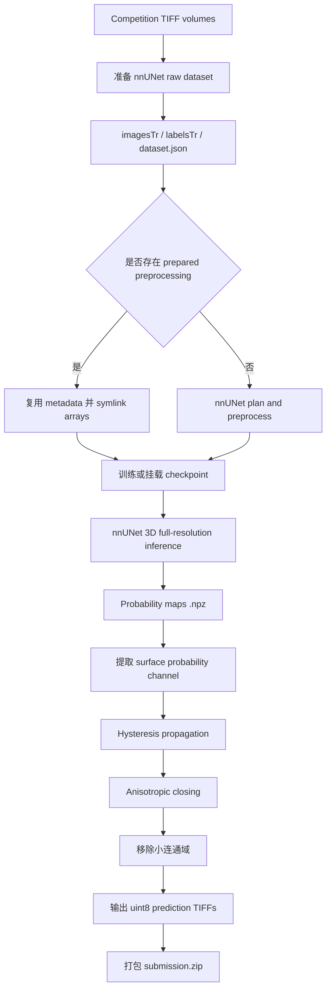

# 🏆 Vesuvius Challenge – Surface Detection

<p align="center">
  <a href="https://www.kaggle.com/competitions/vesuvius-challenge-surface-detection"></a>
  <a href="https://storage.googleapis.com/kaggle-competition-certificates/31156518/532b9eb8ee7083b247b4da26621806d6.png"></a>
  
  
  
  
</p>

<p align="center"><a href="./README.md">English</a> | <b>简体中文</b></p>

<div align="center">
  <a href="https://storage.googleapis.com/kaggle-competition-certificates/31156518/532b9eb8ee7083b247b4da26621806d6.png">
    
  </a>
  <p><em>🏅 Kaggle 官方竞赛证书：Bronze Medal，1,391 支队伍中排名第 85</em></p>
</div>

## 项目概览

本仓库归档 **Vesuvius Challenge – Surface Detection** 的 Kaggle Notebook。代码将体积 TIFF 数据转换为 nnUNet 数据集，复用或生成预处理数据，使用 full-resolution 3D 模型进行推理，再通过 3D 后处理将概率图转换为最终表面 mask，并打包为 `submission.zip`。

### 核心亮点

- **3D segmentation：** 使用 `3d_fullres` 配置、`nnUNetPlannerResEncM` planner 和 `nnUNetResEncUNetMPlans`。
- **大体积数据处理：** 原始 TIFF 默认使用 symlink 接入 nnUNet 数据目录；预处理产物也支持复用重型数组文件。
- **Checkpoint inference：** 归档最终路径使用 2,000-epoch trainer tree 下的 `fold_all/checkpoint_best.pth`。
- **Mask refinement：** 对 class-1 probability map 进行 hysteresis propagation、anisotropic closing 和 connected-component filtering。
- **结果证据：** Bronze Medal，排名 85/1,391，private leaderboard score `0.58952`；证书与官方链接保存在 `evidence/`。

当前仓库的最终路径是基于已提供 checkpoint 的 inference pipeline。Notebook 虽然包含 dataset preparation 与 training wrapper，但没有保存完整的 fold-wise CV ledger 或逐项 ablation 结果，因此文档只描述代码中确实存在的配置。

## 系统架构



## 核心技术实现

### 1. Dataset preparation

Notebook 读取以下目录：

```text
train_images/*.tif
train_labels/*.tif
test_images/*.tif
```

代码创建 `Dataset100_VesuviusSurface`，将训练图像映射为 nnUNet 的 `_0000.tif` 命名格式，生成 spacing JSON sidecar，并在 `dataset.json` 中声明：`background=0`、`surface=1`、`ignore=2`。为避免重复占用存储，原始文件默认采用 symlink。

如果 `/kaggle/input/vesuvius-surface-nnunet-preprocessed` 存在，代码会复制 nnUNet 需要修改的 metadata，并对 `.npz`、`.npy` 和 `.b2nd` 等大文件建立 symlink；否则执行 planner 与 preprocessing。

### 2. Model and inference configuration

| 组件 | 归档配置 |
| --- | --- |
| Framework | `nnunetv2` + PyTorch |
| Dataset | `Dataset100_VesuviusSurface` |
| Configuration | `3d_fullres` |
| Planner | `nnUNetPlannerResEncM` |
| Plans | `nnUNetResEncUNetMPlans` |
| Final fold | `all` |
| Final checkpoint | `fold_all/checkpoint_best.pth`，位于 2,000-epoch trainer tree |
| Final mode | `do_preprocess=False`，`do_train=False` |

仓库没有自定义 neural-network class、custom loss、optimizer、scheduler、EMA、AMP、pseudo-labeling 或 custom head；这些行为由 nnUNet runtime 提供。

### 3. Post-processing

最终 mask refinement 的实际逻辑如下：

1. 从 nnUNet `.npz` 文件读取 `probabilities`。
2. 使用 channel `1` 作为 surface probability map。
3. 使用 `probability >= 0.8` 生成 strong seeds。
4. 在 `probability >= 0.25` 或 non-background argmax anchor 的 weak region 中进行传播。
5. 使用 full 3D connectivity 执行 hysteresis propagation。
6. 使用 `radius_z=3`、`radius_xy=2` 的 anisotropic closing 填补局部间隙。
7. 删除小于 `250` voxels 的 connected components。
8. 保存为 `uint8` TIFF，并打包为 `submission.zip`。

## 结果与证据

归档证据记录：private leaderboard score **`0.58952`**，Bronze Medal，排名 **85/1,391**。由于仓库没有完整 fold-wise CV 或 ablation ledger，以下未保存的实验分数不做推断。

| 证据项 | 记录 |
| --- | --- |
| Award | Bronze Medal |
| Rank | 85 / 1,391 teams |
| Private leaderboard | `0.58952` |
| Final inference | Single `fold_all` checkpoint path |
| Official certificate | `evidence/vesuvius-bronze-certificate.png` |

## 工程目录

```text
.
├── assets/
│   └── certificate.png                         # README Hero 证书图片
├── evidence/
│   ├── links.md                                # 官方 Kaggle 链接
│   └── vesuvius-bronze-certificate.png        # 归档证书图片
├── submission/
│   └── fork-of-surface-nnunet-training-inference-p.ipynb
│                                                  # 下载的 Kaggle Notebook
├── README.md                                    # English 技术文档
└── README_zh.md                                 # 简体中文技术文档
```

## 环境与复现

### Kaggle 输入

将竞赛数据挂载到：

```text
/kaggle/input/vesuvius-challenge-surface-detection/
├── train_images/*.tif
├── train_labels/*.tif
└── test_images/*.tif
```

可选的 prepared preprocessing 数据集：

```text
/kaggle/input/vesuvius-surface-nnunet-preprocessed
```

### 安装与运行入口

Notebook 在 Kaggle 环境中安装和导入：

```bash
pip install nnunetv2 nibabel tifffile tqdm --no-index \
  -f /kaggle/input/surface-packages-offline
```

完整训练路径的主要调用顺序是：

```python
setup_environment()
prepare_dataset(INPUT_DIR)
run_preprocessing(
    dataset_id=100,
    planner="nnUNetPlannerResEncM",
    configurations=["3d_fullres"],
)
run_training(
    dataset_id=100,
    config="3d_fullres",
    fold="all",
    plans="nnUNetResEncUNetMPlans",
    epochs=None,
)
```

归档最终路径使用已经准备好的 checkpoint，跳过 preprocessing 与 training：

```python
full_pipeline(
    do_preprocess=False,
    do_train=False,
    model_path=(
        "/kaggle/working/nnUNet_results/"
        "Dataset100_VesuviusSurface/"
        "nnUNetTrainer_2000epochs__nnUNetResEncUNetMPlans__3d_fullres/"
        "fold_all/checkpoint_best.pth"
    ),
)
generate_submission()
```

最终生成 `/kaggle/working/submission.zip`。仓库没有包含原始体积数据、prepared arrays、checkpoint 或生成的 ZIP；完整复现需要原始 Kaggle 输入、足够的 3D preprocessing 存储，以及可用的 PyTorch/nnUNet runtime。

## 官方链接

- [Competition](https://www.kaggle.com/competitions/vesuvius-challenge-surface-detection)
- [Kaggle Notebook，script version 300492446](https://www.kaggle.com/code/ydhdhej/fork-of-surface-nnunet-training-inference-p?scriptVersionId=300492446)
- [Official certificate image](https://storage.googleapis.com/kaggle-competition-certificates/31156518/532b9eb8ee7083b247b4da26621806d6.png)
