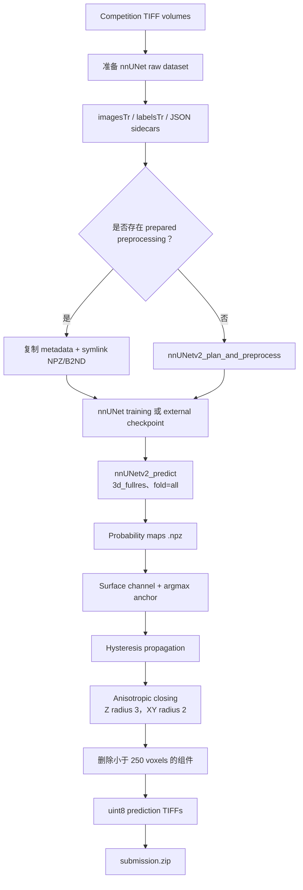

# 🏆 Vesuvius Challenge - Surface Detection — Bronze Medal，85/1,391

<p align="center">
  <a href="https://img.shields.io/badge/Kaggle-Competition-20BEFF?logo=kaggle&logoColor=white&style=flat-square"></a>
  <a href="https://img.shields.io/badge/Award-Bronze%20%7C%2085%2F1391-CD7F32?style=flat-square"></a>
  <a href="https://img.shields.io/badge/Metric-Official%20leaderboard%20score-555555?style=flat-square"></a>
  <a href="https://img.shields.io/badge/Python-3.11-3776AB?logo=python&logoColor=white&style=flat-square"></a>
  <a href="https://img.shields.io/badge/Stack-nnUNet%20%7C%20PyTorch-EE4C2C?logo=pytorch&logoColor=white&style=flat-square"></a>
  <a href="https://img.shields.io/badge/License-Not%20specified-lightgrey?style=flat-square"></a>
</p>

<p align="center"><a href="./README.md">English</a> | <b>简体中文</b></p>

<div align="center">
  <a href="https://storage.googleapis.com/kaggle-competition-certificates/31156518/532b9eb8ee7083b247b4da26621806d6.png">
    
  </a>
  <p><em>🏅 Kaggle 官方竞赛奖状：Bronze Medal，1,391 支队伍中排名第 85</em></p>
</div>

## 1. 方案核心摘要

本仓库保存 **Vesuvius Challenge - Surface Detection** 的 Kaggle Notebook。代码将 TIFF 体数据转换为 nnUNet 数据集，可选复用预处理数据，训练或挂载 nnUNet checkpoint，使用 full-resolution 配置进行 inference，随后对概率图做 surface mask refinement，并将 TIFF 预测打包为 `submission.zip`。

归档 Notebook 保留 source cells 与 runtime metadata；为保持仓库可审阅并避免保存临时 3D 可视化/日志，已清理生成的 cell outputs。

### 赛题与核心挑战

- **任务：** 从 3D TIFF volume 中进行 surface voxel segmentation。
- **输入：** Kaggle 比赛目录下的 `train_images/*.tif`、`train_labels/*.tif` 和 `test_images/*.tif`。
- **标签约定：** background `0`、surface `1`、ignore `2`。
- **系统挑战：** 3D 体数据较大，因此代码使用 symlink、prepared preprocessing、可配置 worker 和持久化 nnUNet results。
- **官方 Metric：** 归档 Notebook 没有保存完整官方 Metric 定义，暂留 `[TODO: 补充 Vesuvius 官方 Metric]`。

### 核心方案

Pipeline 使用 `3d_fullres`、`nnUNetPlannerResEncM` 和 `nnUNetResEncUNetMPlans`。最终 Notebook 调用跳过 preprocessing 与 training，直接挂载 prepared `nnUNetTrainer_2000epochs` 结果树中的 `checkpoint_best.pth`，并开启 probability saving。Post-processing 提取 surface probability channel，通过 strong seeds 到 weak region 的 hysteresis propagation，接着做 anisotropic morphological closing 和 small-component removal，最后输出 uint8 TIFF 并压缩。

## 2. 整体架构与流水线



### 流水线阶段

1. **Environment：** 设置 `nnUNet_raw`、`nnUNet_preprocessed`、`nnUNet_results`、`nnUNet_compile` 与 `nnUNet_USE_BLOSC2=1`。
2. **Raw conversion：** 创建 `Dataset100_VesuviusSurface`，对输入 TIFF 使用 symlink，写入 spacing JSON sidecar，并生成使用 `SimpleTiffIO` 的 `dataset.json`。
3. **Preprocessing：** 如果 `/kaggle/input/vesuvius-surface-nnunet-preprocessed` 存在则复用；否则运行 nnUNet planner/preprocessor。
4. **Training 或 checkpoint mapping：** 可训练指定 fold，也可将外部 `.pth` 映射为 `checkpoint_final.pth`，以便 nnUNet 发现。
5. **Inference：** 将测试 TIFF 准备为 `_0000.tif`，执行 `nnUNetv2_predict --save_probabilities`，保留 `.npz` 做后处理。
6. **Mask refinement 与打包：** refine class-1 probabilities，写出 TIFF mask，并将文件名放在 ZIP 根目录。

## 3. 核心技术细节

### 3.1 Validation Strategy

代码支持两种 fold mode：

- `FOLD=0..4`：用于 five-fold validation 或 fold-level ensemble；
- `FOLD="all"`：用于 full-data training 和 final inference。

归档的最终 cell 使用 `fold="all"`、`do_preprocess=False`、`do_train=False`，因此当前 Notebook **没有包含完整的 five-fold CV 结果表**，而是对外部 checkpoint 做 single-model inference。`[TODO: 如果存在 fold 实验，补充逐 fold CV 分数]`。

### 3.2 数据准备与表示

- 输入约定为 `train_images`、`train_labels`、`test_images` 三个 TIFF volume 目录。
- Training image 映射到 `imagesTr/{case}_0000.tif`，label 映射到 `labelsTr/{case}.tif`。
- JSON sidecar 保存 isotropic spacing `[1.0, 1.0, 1.0]`。
- `dataset.json` 声明一个名为 `CT` 的 channel，labels 为 `background=0`、`surface=1`、`ignore=2`，并指定 `overwrite_image_reader_writer="SimpleTiffIO"`。
- Raw files 默认使用 symlink，避免重复复制大体数据。
- 如果存在 prepared dataset，则复制 metadata 文件，并对 `.npz`、`.npy`、`.b2nd` 等大文件建立 symlink。

### 3.3 Model 与训练配置

Model 由 nnUNet 提供，Notebook 没有自定义 PyTorch class：

| 组件 | 代码中的实际配置 |
| --- | --- |
| Framework | `nnunetv2`，底层使用 PyTorch |
| Dataset ID | `100`（`Dataset100_VesuviusSurface`） |
| Configuration | `3d_fullres` |
| Planner | `nnUNetPlannerResEncM` |
| Plans | `nnUNetResEncUNetMPlans` |
| 默认 fold | `all` |
| 默认 epoch mapping | `EPOCHS=None` 映射为 `nnUNetTrainer`（helper 按 1,000 epochs 处理） |
| 最终归档 checkpoint | `nnUNetTrainer_2000epochs__nnUNetResEncUNetMPlans__3d_fullres/fold_all/checkpoint_best.pth` |
| GPU 选择 | 通过 `torch.cuda.device_count()`，多 GPU 时自动添加 `-num_gpus` |

归档代码没有自定义 Loss、optimizer、scheduler、EMA、AMP、pseudo-labeling 或 custom head；这些行为由 nnUNet runtime 提供。

### 3.4 Inference 与 Post-processing

后处理逻辑是显式且可复现的：

1. 从每个 nnUNet `.npz` 文件读取 `probabilities`；
2. 使用 class channel `1` 作为 surface probability map；
3. 从 `argmax(probabilities) != 0` 构造 anchor mask；
4. 用 `probability >= 0.8` 生成 strong seeds；
5. 允许在 `probability >= 0.25` 或 anchor mask 区域内传播；
6. 使用 full 3D connectivity 做 binary propagation；
7. 使用 `radius_z=3`、`radius_xy=2` 的 anisotropic kernel 做 closing；
8. 删除小于 `250` voxels 的 connected components；
9. 以 `uint8` TIFF 保存。

最终调用不是 ensemble：它使用外部 checkpoint 的 `fold_all`。虽然 helper 支持其他 fold，但归档最终 cell 没有执行 fold blend。

### 3.5 未采用方案与待补实验

- `[TODO]` 对比代码中记录的 `2d`、`3d_lowres`、cascade 与 `3d_fullres`。
- `[TODO]` 对比 standard nnUNet planner 与 `nnUNetPlannerResEncM`。
- `[TODO]` 单独量化 hysteresis threshold、anisotropic closing 和 component filtering。
- `[TODO]` 如果比赛时使用过 fold-0..4 ensemble，补充对应结果。

## 4. 验证与消融结果

归档 portfolio evidence 记录：**Bronze Medal，rank 85/1,391，private leaderboard score 0.58952，颁发日期 February 28, 2026**。Notebook 本身没有完整的 ablation ledger。

| Stage / Experiment | Key Changes | Local CV | Public LB | Private LB |
| :--- | :--- | :---: | :---: | :---: |
| Baseline | nnUNet dataset conversion + default inference | `[TODO]` | `[TODO]` | `[TODO]` |
| Full-resolution model | `3d_fullres` + `nnUNetPlannerResEncM` | `[TODO]` | `[TODO]` | `[TODO]` |
| External checkpoint path | `nnUNetTrainer_2000epochs`、`fold_all`、`checkpoint_best.pth` | N/A | `[TODO]` | `0.58952（归档记录）` |
| Final mask refinement | Hysteresis + closing + small-component removal | `[TODO]` | `[TODO]` | `[TODO]` |

## 5. 工程目录结构

```text
.
├── assets/
│   └── certificate.png                         # README Hero 证书图片
├── evidence/
│   ├── links.md                                # 官方 Kaggle links
│   └── vesuvius-bronze-certificate.png        # 归档证书图片
├── submission/
│   └── fork-of-surface-nnunet-training-inference-p.ipynb
│                                                  # 下载的 Kaggle Notebook
├── README.md                                    # 英文技术文档
└── README_zh.md                                 # 简体中文技术文档
```

## 6. 环境与复现

### 6.1 硬件与运行时

- Notebook metadata 声明 NVIDIA Tesla T4 runtime 与 Python 3.11.13。
- 代码动态检测 CUDA GPU 数量，多 GPU 时会添加 `-num_gpus N`。
- 最终归档调用使用外部 2,000-epoch checkpoint，并跳过 training。
- `[TODO: 补充实际 GPU 数量、显存、preprocessing 时间、inference 时间和 ZIP 大小]`。

### 6.2 安装

Notebook 从 Kaggle offline package directory 安装：

```bash
pip install nnunetv2 nibabel tifffile tqdm \
  --no-index -f /kaggle/input/surface-packages-offline
```

此外还 import `numpy`、`pandas`、`matplotlib`、`scipy`、`scikit-image` 与 `tifffile`。

### 6.3 数据准备

将比赛数据挂载到：

```text
/kaggle/input/vesuvius-challenge-surface-detection/
├── train_images/*.tif
├── train_labels/*.tif
└── test_images/*.tif
```

可选的 prepared preprocessing dataset：

```text
/kaggle/input/vesuvius-surface-nnunet-preprocessed
```

### 6.4 Training、Inference 与提交文件

Notebook 对真实 nnUNet commands 做了 Python wrapper：

```python
setup_environment()
prepare_dataset(INPUT_DIR)
run_preprocessing(
    dataset_id=100,
    planner="nnUNetPlannerResEncM",
    configurations=["3d_fullres"],
)
run_training(
    dataset_id=100,
    config="3d_fullres",
    fold="all",
    plans="nnUNetResEncUNetMPlans",
    epochs=None,
)
```

归档最终路径使用外部 checkpoint，和 Notebook 最后一格一致：

```python
full_pipeline(
    do_preprocess=False,
    do_train=False,
    model_path=(
        "/kaggle/working/nnUNet_results/"
        "Dataset100_VesuviusSurface/"
        "nnUNetTrainer_2000epochs__nnUNetResEncUNetMPlans__3d_fullres/"
        "fold_all/checkpoint_best.pth"
    ),
)
generate_submission()
```

生成文件为 `/kaggle/working/submission.zip`。`generate_submission()` 默认在写入 ZIP 后删除中间 TIFF 文件。

### 6.5 复现边界

仓库不包含大体积比赛数据、preprocessed arrays、nnUNet checkpoints 和生成的 ZIP。复现需要原始 Kaggle datasets、prepared checkpoint 或完整 training run、兼容的 nnUNet 版本以及足够的 3D preprocessing 存储空间。

## 官方链接

- [Competition](https://www.kaggle.com/competitions/vesuvius-challenge-surface-detection)
- [Kaggle Notebook，script version 300492446](https://www.kaggle.com/code/ydhdhej/fork-of-surface-nnunet-training-inference-p?scriptVersionId=300492446)
- [Official certificate image](https://storage.googleapis.com/kaggle-competition-certificates/31156518/532b9eb8ee7083b247b4da26621806d6.png)
